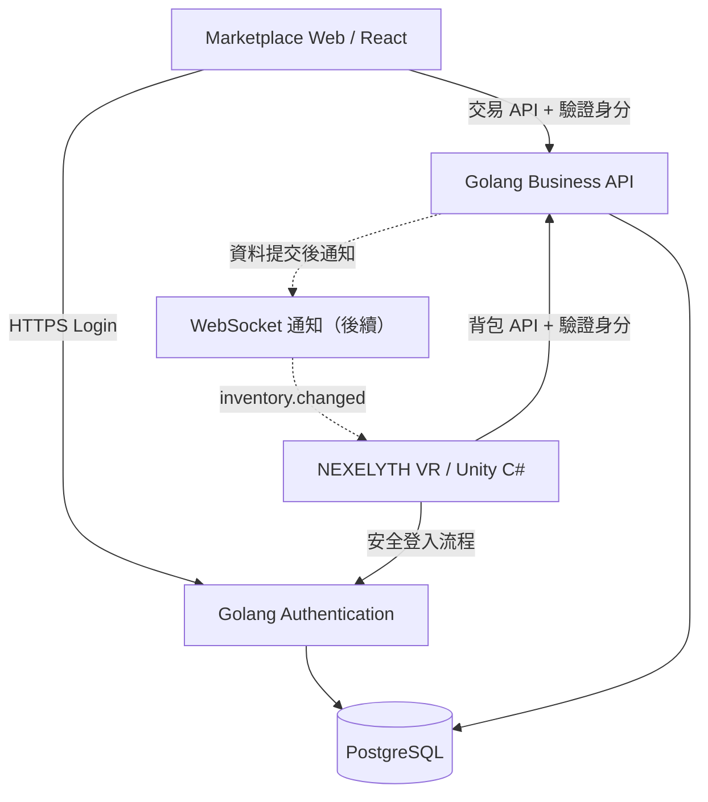
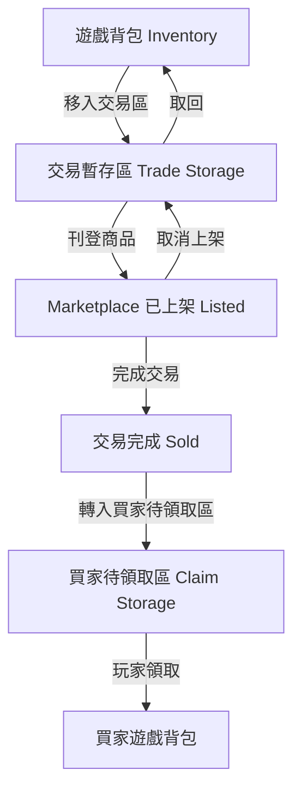
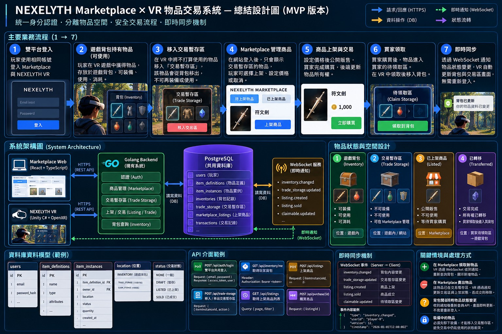

# 001 — Marketplace × NEXELYTH 跨平台整合

**狀態：規劃中**

## 1. 設計目標

- Marketplace 與 Unity VR 共用玩家身分。
- 沿用 Marketplace 現有 Golang 認證機制。
- 遊戲背包與 Marketplace 交易空間分離。
- 物品所有權由後端統一驗證。
- 初期優先使用 REST API，後續導入 WebSocket 同步。

## 2. 系統架構



## 3. 物品空間與狀態



## 4. 核心業務規則

1. Inventory 物品可以裝備或使用。
2. 移入 Trade Storage 後，物品不可裝備或消耗。
3. Marketplace 只能管理該玩家 Trade Storage 的可交易物品。
4. 移入交易區不等於公開上架。
5. 完成交易後才能變更物品所有權。
6. 買家取得物品後，先進入 Claim Storage。
7. Unity 不得直接存取資料庫。
8. 物品狀態修改必須由後端驗證玩家權限。

## 5. 建議資料模型

| 資料表 | 用途 |
|---|---|
| users | 共用玩家身分 |
| item_definitions | 物品種類與設定 |
| item_instances | 個別物品實體、擁有者與位置 |
| marketplace_listings | 上架資料與交易狀態 |
| trade_records | 交易及所有權移轉紀錄 |

上述為目標模型，實作前需先比對現有 PostgreSQL Schema。

## 6. 建議 API（尚未實作）

```http
GET /api/inventory/me
GET /api/trade-storage/me
POST /api/items/{id}/move-to-trade-storage
POST /api/items/{id}/return-to-inventory
POST /api/listings
POST /api/claims/{id}/claim
```

所有玩家專屬 API 都應從已驗證的身分取得 User ID，
不得直接信任前端提交的 playerId。

## 7. 即時同步策略

第一階段：
- 玩家開啟背包時重新查詢 REST API。
- 物品操作成功後主動重新取得最新資料。

後續階段：
- 使用 WebSocket 通知 inventory.changed。
- Unity 收到事件後重新查詢 REST API。
- 斷線重連後重新同步。
- 使用版本號避免舊事件覆蓋新資料。

## 8. 安全性與一致性

- Unity 使用適合原生應用程式的安全登入流程。
- JWT 必須驗證簽章、有效期限、Issuer 及 Audience。
- 物品轉移使用資料庫 Transaction。
- 物品交易需處理重複請求與併發競爭。
- 同一物品實體不得同時存在於可使用背包與交易暫存區。
- WebSocket 事件只通知通過身分驗證的相關玩家。

## 9. 架構決策

### 為什麼重用 Golang Authentication？

Marketplace 已有登入系統，重用可以降低重複開發成本，
也能維持跨平台 User ID 一致性。

### 為什麼分開遊戲背包與交易暫存區？

避免玩家在 VR 使用物品時，Marketplace 同時出售相同物品。

### 為什麼 MVP 不立即拆分 Game API？

初期業務量與複雜度有限，先完成資料一致性的端到端驗證，
再根據需求決定是否建立獨立 Game Backend。

## 10. 尚待決策

- Unity 的實際登入流程與 Token 生命週期
- 現有 PostgreSQL Schema 的沿用方式
- 可堆疊道具的數量拆分規則
- 上架取消、交易失敗及物品退回規則
- WebSocket 通知的可靠性及部署方式

## 系統架構總覽


